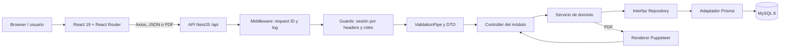
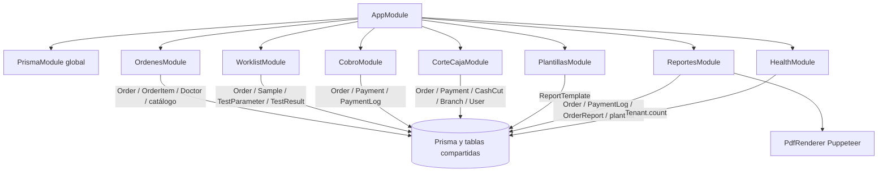

# 03. Arquitectura

Este documento explica cómo se conectan el cliente React, la API NestJS y MySQL, y sigue los cinco flujos principales implementados. Separa dependencias explícitas de módulos de los acoplamientos por tablas compartidas.

## Vista general



El arranque está en `backend/src/main.ts`; la configuración común (prefijo, CORS, middleware, pipes, filtros, guards y Swagger) está en `backend/src/configurar-app.ts`. Todos los módulos de negocio se registran en `backend/src/app.module.ts`; `PrismaModule` es global (`backend/src/prisma/prisma.module.ts`).

## Capas del backend

| Capa | Responsabilidad | Ejemplo |
|---|---|---|
| Controller | Traduce ruta, query, cuerpo y sesión HTTP a una llamada de aplicación. | `backend/src/modules/cobro/cobro.controller.ts`. |
| DTO | Describe/valida la forma de algunos cuerpos y queries. `ValidationPipe` global rechaza campos no permitidos y transforma tipos. | `backend/src/modules/corte-caja/dto/cerrar-corte.dto.ts`. |
| Dominio | Servicios, reglas puras, tipos y errores de negocio. | `backend/src/modules/worklist/dominio/worklist.service.ts`, `worklist.rules.ts`. |
| Repository (dominio) | Contrato de operaciones de persistencia, independiente de Prisma. | `backend/src/modules/ordenes/dominio/ordenes.repository.ts`. |
| Infraestructura | Implementa contratos mediante consultas/transacciones Prisma. | `backend/src/modules/ordenes/infra/ordenes-prisma.repository.ts`. |
| Módulo Nest | Registra controller, token, adaptador y servicio mediante factory. | `backend/src/modules/ordenes/ordenes.module.ts`. |

El patrón está mejor separado en los módulos de órdenes, cobro, worklist, reportes y corte. No todos tienen exactamente los mismos archivos. Ninguno de los módulos funcionales declara exports para compartir servicios; sus repositorios sí consultan tablas que otros módulos también usan. No encontré bus de eventos ni colas.

### Dependencias por módulo



Las flechas que llegan a la base muestran uso de datos, no imports directos entre módulos. Por ejemplo, `ReportesPrismaRepository` escribe `PaymentLog` y modifica `Order.resultsDeliveredAt`, mientras `CorteCajaPrismaRepository` enlaza pagos a un `CashCut`. Cambiar esos modelos exige revisar varios flujos.

## Estructura del repositorio

```text
backend/
  src/auth/                 guards, decoradores y sesión leída de headers
  src/comun/                filtros, pipe, middleware y errores comunes
  src/modules/<feature>/    controller, DTO, dominio, infra y pruebas
  src/prisma/               cliente Prisma compartido
  prisma/                   schema y seeds
  scripts/                  preparación de base para desarrollo/Compose
frontend/
  src/pages/                pantallas principales
  src/features/             features de cobro, entrega y worklist
  src/components/           componentes reutilizables
  src/compartido/           sesión, API, layout y utilidades
  Dockerfile + nginx.conf   build estático y fallback SPA
docker-compose.yaml         MySQL, API y frontend
RAILWAY.md                  instrucciones de demo en Railway
docs/                       documentación, incluida DEFECTOS.md
```

No hay workspace raíz de npm ni configuración de CI visible bajo `.github` en el inventario del repositorio.

## Estructura del frontend

`frontend/src/main.tsx` monta `App` en React StrictMode. `frontend/src/App.tsx` crea el `SesionProvider`, `BrowserRouter`, `Layout` y rutas. Lista de trabajo, cobro, entrega y página ejemplo usan `React.lazy`; recepción, corte y plantillas se importan directamente.

Rutas actuales:

| Ruta del navegador | Página |
|---|---|
| `/recepcion/nueva-orden` | `pages/OrderCapturePage.tsx` |
| `/resultados/lista-de-trabajo` y `/:idOrden` | `features/lista-de-trabajo/` |
| `/ordenes/cobro` | `features/cobro/` |
| `/ordenes/corte-caja` | `pages/CashCutPage.tsx` |
| `/resultados/entrega` | `features/entrega/PaginaEntrega.tsx` + `ReportViewerModal` |
| `/resultados/plantillas` | `pages/ReportTemplatePage.tsx` |

El estado de servidor se carga principalmente con Axios y hooks locales (`useEffect`/`useState`); no hay caché de datos compartida identificada. Existen dos instancias Axios con configuración semejante en `frontend/src/services/api.ts` y `frontend/src/compartido/api.ts`.

## Ciclo de una petición

1. La vista llama un servicio Axios con base URL `VITE_API_URL` y encabezado `x-tenant-id` (`frontend/src/services/api.ts`).
2. Nest aplica prefijo `/api`, CORS, middleware de request ID, `ValidationPipe` global, filtros y guards (`backend/src/configurar-app.ts`).
3. `SesionPorEncabezadosGuard` crea el objeto de sesión desde headers; `RolesGuard` consulta metadata `@Roles` si existe.
4. Controller invoca servicio de dominio; el servicio valida reglas y llama una interfaz repository.
5. Repository Prisma lee/escribe MySQL, frecuentemente incluyendo los `tenantId` del request.
6. Nest serializa JSON o el controller responde PDF/CSV. Axios actualiza el estado local de React.

## Flujos clave

### Crear orden

`OrderCapturePage` busca `GET /concepts/search`, consulta `/orders/check-open` y envía `POST /orders` (`frontend/src/pages/OrderCapturePage.tsx`). `OrdenesController` pasa tenant y DTO a `OrdenesService`; este calcula folio y arma conceptos (`backend/src/modules/ordenes/dominio/ordenes.service.ts`, `ordenes.rules.ts`). `OrdenesPrismaRepository` crea `Order` y los `OrderItem` relacionados. Responde `{ success, folio, orderId }`; la UI muestra el folio y vacía el carrito.

La página usa actualmente un paciente fijo y hace `GET /doctors`, ruta no declarada en `OrdenesController`; su error se ignora. El alta express se realiza con `POST /doctors/express`.

### Captura de resultados

`PaginaListaDeTrabajo` carga `GET /worklist`; `useCapturaDeResultados` obtiene `GET /worklist/orders/:id`, prepara valores y envía `POST /worklist/orders/:id/results` (`frontend/src/features/lista-de-trabajo/servicio.ts`). `WorklistService` calcula edad, selecciona rango por edad/sexo, determina pendientes y valida captura. `WorklistPrismaRepository` lee órdenes con muestra `received` y guarda resultados con transacción. Tras guardar, el hook vuelve a consultar la orden/lista y navega o muestra confirmación.

Los resultados críticos `HH`/`LL` se bloquean hasta que exista una notificación registrada; el código de la API revisado no proporciona un endpoint para registrar esa notificación.

### Cobro

`PaginaCobro` usa `cobroApi.ts` para `GET /orders/:id/billing` y `POST /orders/:id/payments`; para anular llama `POST /payments/:id/cancel`. `CobroService` arma el estado de cobro y valida descuentos, referencias y saldo. El repositorio bloquea la orden y, en una transacción, actualiza montos, inserta pagos y escribe `PaymentLog`. El servicio devuelve el estado actualizado para refrescar la pantalla.

### Corte de caja

`CashCutPage` consulta `/cash-cuts/context` y `/cash-cuts/summary`; al cerrar envía `POST /cash-cuts/close` con sucursal, cajero, turno, fecha y efectivo contado. `CorteCajaService` calcula diferencia y exige observación si hay descuadre; el repository guarda corte/snapshot y asigna pagos elegibles en transacción. La pantalla vuelve a solicitar el resumen. El historial y exportación usan `GET /cash-cuts` y `GET /cash-cuts/:id/export`.

### Generar y liberar PDF

`PaginaEntrega` abre `ReportViewerModal`, que envía `POST /reports/orders/:orderId/pdf` como blob y agrega canal/motivo cuando corresponde. `ReportesController` llama `ReportesService.release`. El servicio recalcula saldo, registra bloqueos/excepciones, obtiene plantilla/token QR y pide el PDF a `PdfRenderer`. `ReportesPrismaRepository` mantiene una transacción con bloqueo de fila; `PdfPuppeteerRenderer` delega en `pdf.service.ts`. El controller responde `application/pdf` o `409 PAYMENT_REQUIRED`; el modal muestra/descarga el blob.

La opción de canal se registra como contexto de liberación; no hay integración de envío de correo/portal en el código revisado (`backend/HU-5.5.md`).
