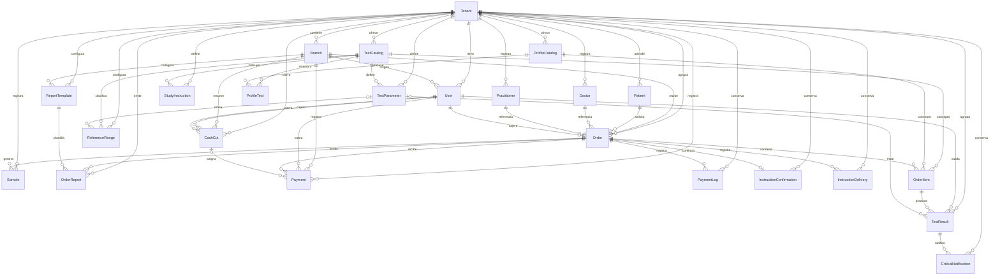

# 04. Base de datos

Este documento describe el esquema relacional definido por Prisma, sus relaciones y cómo el repositorio prepara los datos. No se ha conectado a MySQL ni se ha ejecutado ningún cambio de esquema.

## Motor y ORM

- Motor: MySQL, `provider = "mysql"` en `backend/prisma/schema.prisma`; Compose usa la imagen `mysql:8.0`.
- ORM/cliente: Prisma Client, `@prisma/client ^6.19.3` y CLI `prisma ^6.19.3` en `backend/package.json`.
- Conexión: variable `DATABASE_URL`; `PrismaService` conecta al iniciar el módulo y desconecta al destruirlo (`backend/src/prisma/prisma.service.ts`).
- El esquema genera el cliente `prisma-client-js`.

## Diagrama ER

## Modelos

Las tablas físicas usan los nombres `@@map` indicados en `backend/prisma/schema.prisma`.

| Modelo / tabla | Propósito y relaciones principales |
|---|---|
| `Tenant` / `tenants` | Laboratorio y raíz de aislamiento; nombre, subdominio único y estado. Tiene sucursales, usuarios, pacientes, catálogo, órdenes, pagos y demás datos del dominio. |
| `Branch` / `branches` | Sucursal perteneciente a tenant; asociada a usuarios, órdenes, pagos, cortes y plantillas. |
| `User` / `users` | Usuario, sucursal opcional, email único global, hash de contraseña y rol. Se relaciona con validación de resultados, caja, pagos e indicaciones. No hay login API visible que valide `passwordHash`. |
| `Patient` / `patients` | Identidad clínica básica, fecha de nacimiento, sexo y contactos; relacionado con órdenes. `patientCode` es único por tenant cuando no es nulo. |
| `Doctor` / `doctors` | Médico solicitante con cédula/especialidad/contacto; opcional en orden. No confundir con `Practitioner`. |
| `TestCatalog` / `test_catalog` | Catálogo de estudios: código, precio, tipo de muestra, restricción de sexo, rango textual legado, laboratorio externo y tiempo estimado. Relacionado con parámetros, rangos, instrucciones, perfiles y conceptos de orden. |
| `ProfileCatalog` / `profile_catalogs` | Perfil vendible con precio/estado; agrupa estudios mediante `ProfileTest` y puede ser concepto de orden. |
| `ProfileTest` / `profile_tests` | Tabla puente con clave compuesta `(profileId, testId)` para la relación muchos-a-muchos perfil-estudio. |
| `Order` / `orders` | Orden por tenant, sucursal y paciente; médico, practitioner y cajero opcionales. Guarda montos, descuento, estado, folio, factura y fecha de entrega. Agrupa líneas, muestras, resultados indirectamente, pagos, bitácora, informe e indicaciones. |
| `OrderItem` / `order_items` | Concepto de una orden y precio persistido; enlaza opcionalmente un estudio o perfil. Tiene resultados. El esquema no impone que solo uno de `testId`/`profileId` esté definido. |
| `Sample` / `samples` | Muestra con código de barras, estado, timestamps, descripción/equipo/capturista; pertenece a orden y tenant. |
| `TestResult` / `test_results` | Valor/flag/alerta/estado de un parámetro en un `OrderItem`; validador opcional. Índice único por `(orderItemId, parameterId)`. |
| `ReportTemplate` / `report_templates` | Versión y presentación de informe por tenant, con rama opcional, estilo, URLs y textos. |
| `OrderReport` / `order_reports` | Informe de orden emitido; referencia template y almacena token QR único, URL PDF opcional y fecha. |
| `Payment` / `payments` | Pago por método, monto, referencia, cajero/corte opcionales y datos de anulación. Nunca se elimina para cancelar: queda marcado `cancelled`. |
| `PaymentLog` / `payment_logs` | Bitácora textual de pagos, descuentos, cancelaciones y eventos de liberación; usuario se conserva como nombre. |
| `CashCut` / `cash_cuts` | Corte por tenant/sucursal/cajero/fecha/turno; montos por método, diferencia, observación, snapshot JSON y datos de cierre. |
| `Practitioner` / `practitioners` | Profesional médico asociado a tenant y órdenes por `physicianId`; el seed crea tanto `Doctor` como `Practitioner`. Por confirmar: diferencia funcional aprobada entre ambos. |
| `StudyInstruction` / `study_instructions` | Indicación por estudio: tipo, horas y texto. No encontré API para consultar/aplicar estas filas. |
| `InstructionConfirmation` / `instruction_confirmations` | Confirmación única por orden, con usuario/sucursal/observación. No encontré endpoint que la escriba. |
| `InstructionDelivery` / `instruction_deliveries` | Registro de canal de entrega de indicaciones por orden. No encontré endpoint que la escriba. |
| `TestParameter` / `test_parameters` | Parámetro ordenado de un estudio; unidad, esperado cualitativo y valor previo opcional. Tiene rangos y resultados. |
| `ReferenceRange` / `reference_ranges` | Rango opcionalmente ligado a parámetro y filtrable por sexo/edad; incluye límites, inclusividad y valores críticos. |
| `CriticalNotification` / `critical_notifications` | Auditoría de notificación crítica a paciente/médico y método de contacto. El esquema existe, pero no encontré endpoint/servicio que lo use. |

## Enums

| Enum | Valores |
|---|---|
| `TenantStatus` | `active`, `suspended`, `inactive` |
| `UserRole` | `admin`, `receptionist`, `chemist`, `doctor` |
| `Gender` | `M`, `F`, `Other` |
| `OrderStatus` | `pending`, `in_process`, `completed`, `cancelled` |
| `SampleStatus` | `collected`, `received`, `rejected`, `processed` |
| `ResultStatus` | `captured`, `validated` |
| `PaymentMethod` | `cash`, `card`, `transfer` |
| `CashCutStatus` | `open`, `closed` |
| `CashCutShift` | `matutino`, `vespertino`, `nocturno` |
| `InstructionType` | `fasting`, `first_urine`, `medication`, `text` |
| `DeliveryChannel` | `whatsapp`, `email` |
| `CriticalRecipient` | `doctor`, `patient` |
| `CriticalContactMethod` | `phone`, `email`, `whatsapp`, `in_person` |

## Índices y unicidad relevantes

- Únicos globales: `Tenant.subdomain`, `User.email`, `Order.folio`, `Sample.barcode`, `OrderReport.qrToken`.
- Compuestos: catálogo `(tenantId, code)`; paciente `(tenantId, patientCode)`; perfil-estudio `(profileId, testId)`; resultado `(orderItemId, parameterId)`; corte `(tenantId, branchId, cashierId, cutDate, shift)`; practitioner `(tenantId, fullName)`; parámetro `(testId, name)`; confirmación por `orderId`; instrucción `(testId, type, text)`.
- Hay índices en claves de relación/tenant declarados en schema, incluyendo órdenes por `tenantId`, `patientId`, `doctorId`, `branchId`; pagos por orden, cajero, corte, sucursal y `(tenantId, branchId, createdAt)`.
- No todos los índices de tenant forman claves compuestas con el ID relacionado. Por confirmar: restricciones físicas adicionales fuera de Prisma.

## Multi-tenancy

La mayoría de tablas de negocio almacena `tenantId`; los repositorios filtran por tenant en sus consultas y el guard obtiene ese ID desde `x-tenant-id`. Esto es aislamiento lógico dentro de una base compartida, no una base separada por laboratorio. El ID del encabezado no es una credencial autenticada. Además, algunas relaciones de orden usan FKs simples, sin validar automáticamente que sucursal/paciente/médico correspondan al mismo tenant. Ver `docs/DEFECTOS.md` para el hallazgo de aislamiento.

## Evolución del esquema, migraciones y seeds

No existe una carpeta `backend/prisma/migrations` en el árbol revisado. La ruta está declarada en `backend/prisma7.config.ts`, pero la herramienta declarada en `backend/package.json` es Prisma 6; por confirmar si dicho archivo se usa. Los scripts visibles sincronizan el esquema con `prisma db push`, no aplican migraciones versionadas.

| Comando en `backend/` | Comportamiento definido |
|---|---|
| `npm run db:preparar` | `scripts/preparar-bd.cjs`: crea `.env` desde `.env.example` si falta, genera cliente, reintenta `prisma db push --skip-generate` y llama al seed con `--si-vacia`. Es `predev`, así que corre antes de `npm run dev`. |
| `npm run db:seed` | Ejecuta `prisma/seed.ts` sin el flag de “solo vacía”. `sembrarDemo` elimina y recrea el tenant demo encontrado por nombre/subdominio; no ejecutarlo contra datos reales. |
| `npm run db:reset` | Ejecuta `prisma db push --force-reset` y luego seed. El reset afecta a toda la base configurada. |

`seed.ts --si-vacia` comprueba si existe al menos un tenant y omite seed en ese caso. Los datos demo se construyen en `backend/prisma/seeds/demo.ts`, `demo-ordenes.ts` y `demo-catalogo.ts` e incluyen sucursales, usuarios, pacientes, catálogo/rangos, órdenes, pagos, plantilla y cortes. El README indica que hay 21 órdenes; los IDs no son estables.
